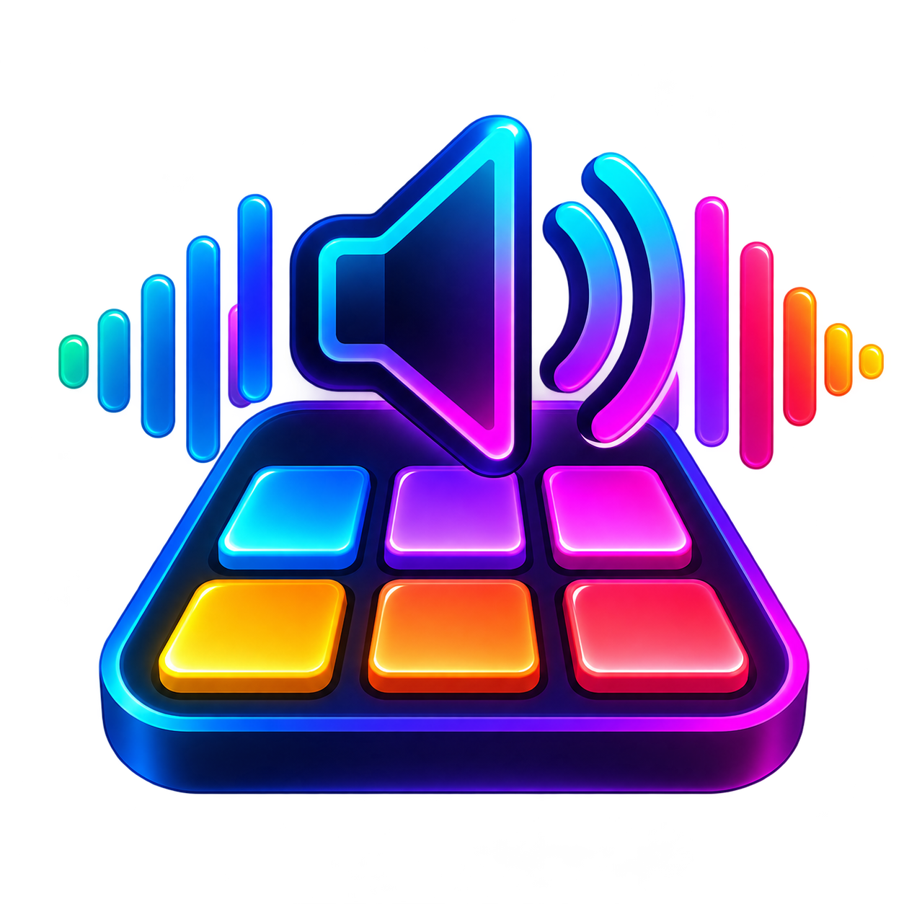
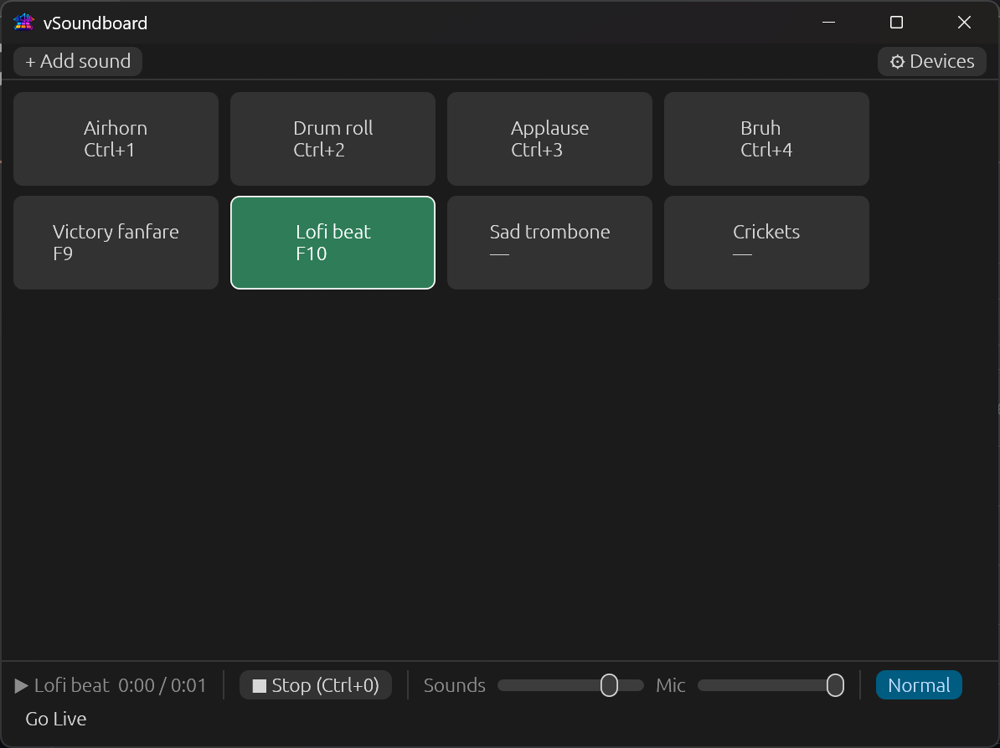
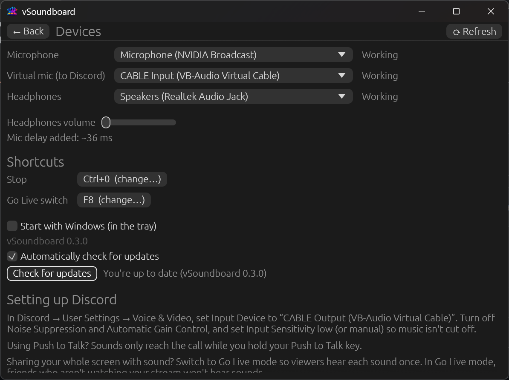

<p align="center">
  
</p>

<h1 align="center">vSoundboard</h1>

<p align="center">
  A free, open-source soundboard for Windows. Play sound effects and music into your Discord calls with keyboard shortcuts.
</p>

<p align="center">
  <a href="https://github.com/mmhy2003/vSoundboard/releases/latest"></a>
  <a href="https://github.com/mmhy2003/vSoundboard/actions/workflows/ci.yml"></a>
  <a href="LICENSE"></a>
  
</p>

<p align="center">
  
</p>

The people in your Discord call hear your sounds mixed with your voice, and you hear them in your headphones too. You don't need a hardware soundboard.

## Features

- **A pad for every sound.** Drag in MP3, WAV, OGG or FLAC files and click a pad to play it. A new sound cuts off the one that's playing.
- **Global keyboard shortcuts.** Shortcuts work while Discord or a game has focus.
- **Your voice and your sounds, together.** Your real mic is mixed with the sounds into a virtual mic for Discord, with low added delay.
- **Hear what they hear.** Sounds also play in your headphones, at their own volume.
- **Go Live mode.** It avoids double audio when you share your whole screen with sound.
- **Lives in the tray.** It can start with Windows, hidden, ready to go.
- **Easy setup.** The installer can also fetch VB-Cable for you.
- **Automatic updates.** It asks politely, only when you're looking at it, never mid-game.

## How it works

```
Your mic ──────┐
               ├─► mix ──► CABLE Input ──► Discord's mic = "CABLE Output"
Current sound ─┤
               └─► your headphones (sound only)
```

Windows doesn't let an ordinary app create a microphone, so vSoundboard uses the free **VB-Cable** virtual audio cable as Discord's mic.

## Install

1. Download `vSoundboard-Setup-X.Y.Z.exe` from the [latest release](https://github.com/mmhy2003/vSoundboard/releases/latest).
2. Run it. The installer isn't code-signed, so Windows may show "Windows protected your PC". Click **More info → Run anyway**.
3. Choose your options:
   - **Desktop shortcut.**
   - **Start vSoundboard when Windows starts.** It starts hidden in the tray; you can change this later under ⚙ Devices.
   - **Download and install VB-Cable**, offered only if it's missing. The installer fetches VB-Audio's official package and runs their setup, which asks for administrator permission. VB-CABLE is made by VB-Audio (https://vb-cable.com) and is donationware: free to use, and you can support VB-Audio at vb-cable.com.
4. If you installed VB-Cable, **restart your PC** before using vSoundboard in Discord.

It installs just for your user (no administrator rights needed for vSoundboard itself). Uninstalling from Windows' Apps settings keeps your sounds and shortcuts, and leaves VB-Cable installed.

## Setup

<p align="center">
  
</p>

1. **VB-Cable:** if you didn't install it with the installer, get it free from https://vb-audio.com/Cable/ and restart your PC.
2. **Start vSoundboard** and click **⚙ Devices**:
   - **Microphone:** your real mic.
   - **Virtual mic (to Discord):** "CABLE Input (VB-Audio Virtual Cable)". This is picked automatically when VB-Cable is installed.
   - **Headphones:** where you want to hear the sounds yourself.
3. **In Discord**, go to User Settings → Voice & Video:
   - Set **Input Device** to "CABLE Output (VB-Audio Virtual Cable)".
   - Turn off **Noise Suppression** and **Automatic Gain Control**.
   - Set **Input Sensitivity** low (or manual), so music isn't cut off.

If you use Push to Talk, sounds only reach the call while you're holding your Push to Talk key.

## Using it

- **Add sounds:** drag MP3, WAV, OGG or FLAC files onto the window, or click **+ Add sound**. Files stay where they are on your PC; vSoundboard just remembers where they are.
- **Play:** click a pad or press its shortcut. Shortcuts work while Discord or a game has focus. Starting a new sound cuts off the one that's playing. Clicking the playing pad again, or pressing its shortcut, stops it.
- **Drag a pad** to move it: drop it on another pad to take that spot (the others shift along), or in the empty space to move it to the end. Esc cancels.
- **Right-click a pad** to rename it, set its shortcut, change its volume, or remove it.
- **Stop:** use the ■ Stop button, or set a Stop shortcut under ⚙ Devices.
- **Shortcuts are taken over:** the key press goes to vSoundboard and doesn't reach the game, so pick combinations you don't use in-game. Letters and other typing keys need Ctrl or Alt.
- **📌 Always on top** (top bar) keeps the window above other windows. Click it again to turn it off; it's remembered between restarts.
- **Closing the window** keeps vSoundboard running in the system tray, so shortcuts keep working. Use the tray icon's menu to show the window again or quit.

### Go Live mode

If you share your **whole screen with sound**, Discord also records the copy of each sound playing in your headphones, so viewers would hear it twice. Switch the bottom bar to **Go Live**. Sounds then play only to your headphones, and your screen share carries them to viewers once. In Go Live mode, friends in the call who aren't watching your stream won't hear sounds. You can give the switch a shortcut under ⚙ Devices.

## Updates

vSoundboard checks GitHub for a new version when it starts and every 6 hours.

- **When it asks:** only while its window is open and in front. It never interrupts a game or pops up from the tray.
- **Update now** downloads the new installer, checks it against the checksum GitHub publishes, installs it, and restarts vSoundboard. Your voice in Discord drops for a few seconds while it restarts.
- **Later** hides the reminder for 24 hours.
- **What updates don't change:** your sounds, shortcuts, Start with Windows choice or VB-Cable.
- **If an update can't be installed,** the current version keeps running and vSoundboard tells you, with a link to download it manually.
- Under ⚙ Devices you can turn off **Automatically check for updates**, or click **Check for updates**.

## Settings file

Everything is saved automatically to `%APPDATA%\vSoundboard\config.json`. If that file gets damaged, vSoundboard starts fresh and keeps the old file next to it as `config.json.bad-<number>`.

## Contributing

Contributions are welcome: bug reports, ideas, documentation and code.

- **Found a bug or have an idea?** [Open an issue](https://github.com/mmhy2003/vSoundboard/issues). For bugs, include your Windows version, your vSoundboard version (shown under ⚙ Devices) and the steps to reproduce.
- **Want to change something?** Read [CONTRIBUTING.md](CONTRIBUTING.md) for how to build, test and send a pull request. Pull requests go to the `develop` branch.

## Building from source

You need:

- **Rust** (stable, MSVC toolchain) and the **Visual Studio C++ Build Tools**.
- [**Inno Setup 7**](https://jrsoftware.org/isinfo.php) with `iscc` on PATH, and **GNU Make**. These are only needed to build the installer.

```
make check                 # format check, lint and tests (what CI runs)
cargo run                  # run the app
make installer             # dist\vSoundboard-Setup-<version>.exe
cargo run --example smoke  # plays a test tone through VB-Cable and reports what arrived
```

Run `make` to list every target.

## Built with

- [Rust](https://www.rust-lang.org/)
- [egui/eframe](https://github.com/emilk/egui) for the window
- [cpal](https://github.com/RustAudio/cpal) for audio devices
- [symphonia](https://github.com/pdeljanov/Symphonia) for decoding
- [rubato](https://github.com/HEnquist/rubato) for resampling
- [global-hotkey](https://github.com/tauri-apps/global-hotkey) and [tray-icon](https://github.com/tauri-apps/tray-icon) for shortcuts and the tray
- [Inno Setup](https://jrsoftware.org/isinfo.php) for the installer

VB-CABLE is a separate product made by [VB-Audio](https://vb-cable.com) and is not part of this project.

## License

vSoundboard is released under the [MIT License](LICENSE).
